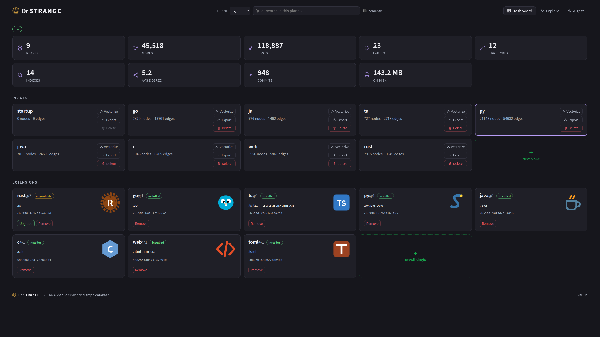
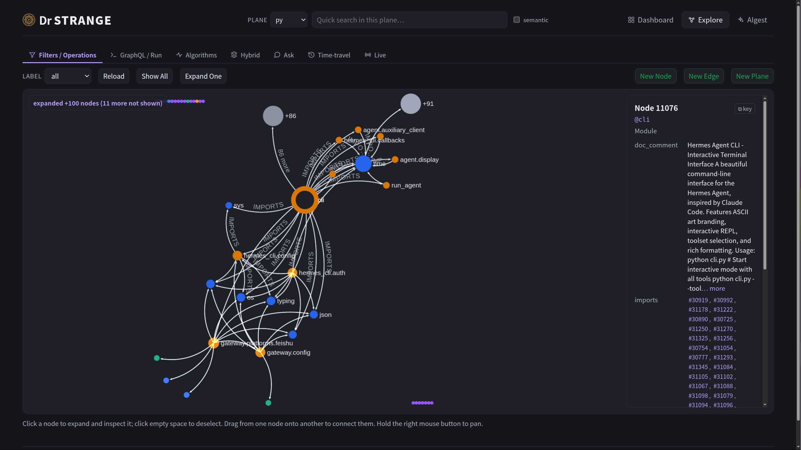
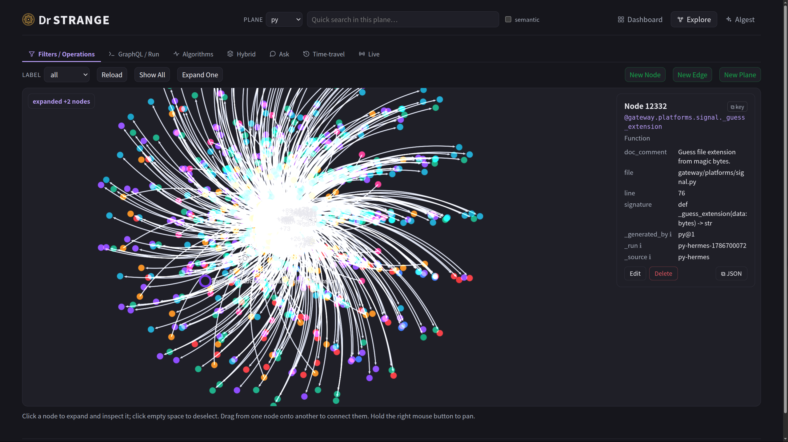

<p align="center">
  
</p>

<h1 align="center">Dr Strange</h1>

<p align="center"><em>让你的编码智能体去问图，而不是翻文件。</em></p>

<p align="center">
  <a href="https://github.com/wangyingsm/dr-strange/actions/workflows/ci.yml"></a>
  <a href="https://github.com/wangyingsm/dr-strange/actions/workflows/release.yml"></a>
  <a href="https://github.com/wangyingsm/dr-strange/actions/workflows/docs.yml"></a>
  <a href="https://github.com/wangyingsm/dr-strange/releases/latest"></a>
  <a href="LICENSE-MIT"></a>
</p>

<p align="center">
  <em>一条命令配好你正在用的那个智能体：</em><br>
  
  
  
  
  
  
</p>

<p align="center"><a href="README.md">English</a> · <strong>简体中文</strong></p>

📖 **Dr Strange 手册** —— 完整教程与指南：
[English](https://wangyingsm.github.io/dr-strange/en/book/introduction.html) ·
[中文](https://wangyingsm.github.io/dr-strange/zh/book/introduction.html)。

## 回答一个代码问题要花多少

问智能体一句*改这里会影响什么*。没有图，它只能 grep 一个名字，再把匹配到的文件
逐个读完——在本仓库上，这是中位 **53,720** 个 token。同一个问题交给已消化的图，是
**925** 个：一次 `context` 调用，返回已解析的调用方与被调用方，不打开任何文件。

| | |
|---|---|
| 消化本仓库——9.7 万行，13 个解析插件 | **3.1 秒**，全程无模型参与 |
| 回答"谁调用了它、改动会波及到哪里" | token 用量为 **1/61**（中位，n=12） |

两个数字都是实测而非估算，且都可复现。方法、脚本，以及为使第二个数字站得住脚而
设的排除项，都记在
[BENCHMARKS.md](BENCHMARKS.md#answering-a-code-question--graph-vs-text-search)
里——若把 `new` 这样的名字也算进去，比值会变成 2,600 倍，所以通用名称的符号被排除
在样本之外。

## 三条命令

```console
$ curl -fsSL https://raw.githubusercontent.com/wangyingsm/dr-strange/master/scripts/install.sh | sh
$ drsg plugin install          # 从官方目录中挑选解析器；0 表示全选
$ drsg init                    # 消化、起服务，并写入你的智能体会读的 MCP 配置
```

`drsg init` 消化当前工作区，起一个把每次提交折叠进图的 watcher，写入 `.mcp.json`，
并为本仓库或本机留有痕迹的那些智能体写好对应配置。此后你的智能体便拥有 `context`、
`impact`、`trace`、`wire`、`grep` 等一组工具，每个都只需一次往返。以上全程不涉及
任何模型。

## 简介

它同时也是一个图数据库——一个从设计之初便面向 AI 工作负载的图数据库：向量嵌入（embedding）
是一等的值类型，相似度检索与图遍历并行工作，引擎直接向智能体（agent）暴露契合其
需求的原语——自然语言查询、实时变更流与时间旅行——而非在传统图数据库之上事后叠加
AI 功能。

与 SQLite 类似，它是**嵌入式**的：以库的形式链接进应用，由单个磁盘文件承载，无需
运维独立的服务进程。但与 SQLite 不同，它同样可以**对外服务**——`drsg serve` 提供
JSON-RPC 2.0 接口、浏览器控制台以及 WebSocket 变更流，并配有六种语言的客户端 SDK。

上面那套代码智能正建立在同一台引擎之上。沙箱化的 wasm 解析器插件将一个代码仓库
图化为符号与已解析关系——官方共十三个插件，其中八个是语言，全程无需模型参与——`drsg serve watch` 让这张图随
每一次提交保持同步，一组紧凑的智能体工具则以单次往返回答结构性问题（谁调用了它、
改动它会影响什么、X 如何到达 Y）。参见[面向编码智能体](#面向编码智能体)。

对于围绕知识图谱、GraphRAG 流水线或智能体长期记忆构建的应用，Dr Strange 力求成为
承载这一切的单一存储。

## Web UI 截图

`drsg serve` 附带一个浏览器控制台。更多内容见 [Web 界面
章节](https://wangyingsm.github.io/dr-strange/zh/book/web-ui.html)。

<table>
  <tr>
    <td width="50%"><a href="screenshots/00.jpg"></a><br><sub><b>Dashboard</b> —— 实时统计、平面管理与已安装的解析器插件</sub></td>
    <td width="50%"><a href="screenshots/01.jpg"></a><br><sub><b>Explore</b> —— 交互式图谱与节点详情</sub></td>
  </tr>
  <tr>
    <td width="50%"><a href="screenshots/02.jpg"></a><br><sub><b>Algorithms</b> —— PageRank、社区发现与最短路径</sub></td>
    <td width="50%"><a href="screenshots/03.jpg"></a><br><sub><b>AIgest</b> —— LLM 文档摄取，抽取实体与关系</sub></td>
  </tr>
  <tr>
    <td width="50%"><a href="screenshots/04.jpg"></a><br><sub><b>代码图</b> —— 已图化平面上一个模块的导入邻域</sub></td>
    <td width="50%"><a href="screenshots/05.jpg"></a><br><sub><b>代码平面</b> —— 整张图一览；每条事实都带文件、行号、签名与解析它的插件</sub></td>
  </tr>
</table>

## 特性

| 能力 | 提供的价值 |
|---|---|
| **平面（Planes）** | 单个数据库中承载多个相互独立的图 |
| **一等向量嵌入** | 向量属性，原生以 HNSW 建立索引 |
| **混合检索** | 融合向量 + 关键词（BM25）+ 图邻近度的检索 |
| **查询语言** | 可序列化的逻辑计划，以及 openCypher 子集 |
| **图算法** | PageRank、连通分量、最短路径、Louvain |
| **自然语言查询** | 以自然语言提问 → 生成计划 → 执行 |
| **时间旅行** | 读取图在过去某次提交或某个时间戳**时刻**的状态 |
| **变更流** | 订阅某个平面并实时接收其变更 |
| **代码图化** | 沙箱化的 wasm 解析器插件将代码仓库转化为已解析的调用图——官方支持 8 种语言，并提供社区解析器 SDK |
| **提交同步监视** | `serve watch` 将每次提交折叠进平面，结果与全量重新消化收敛一致 |
| **智能体工具** | `context` · `search` · `describe` · `grep` · `trace` · `impact` · `fathom` · `snippet` · `history` · `recall` · `wire`——每个问题一次往返 |
| **备份 / 恢复** | 一致且保留 id 的全库快照 |
| **接口** | Web 控制台、六种语言 SDK、命令行工具，以及提供智能体工具的 MCP 服务器 |

依赖模型的功能（自然语言查询、文档摄取与文本嵌入检索）会调用外部或本地的 LLM；其余
功能均无需任何模型即可运行。参见[附录 C](https://wangyingsm.github.io/dr-strange/zh/book/appendix-c.html)。

## 安装

一行命令，无需工具链。安装脚本会下载对应平台的已发布二进制、校验其 SHA-256，并把
它放到你的 `PATH` 上。共发布两个二进制：命令行与服务端 `drsg`，以及 stdio 的 MCP
服务端 `drsg-mcp`。

**Linux 与 macOS**（Apple 芯片与 Intel 均可）

```console
$ curl -fsSL https://raw.githubusercontent.com/wangyingsm/dr-strange/master/scripts/install.sh | sh
```

**Windows**（PowerShell）

```console
PS> irm https://raw.githubusercontent.com/wangyingsm/dr-strange/master/scripts/install.ps1 | iex
```

`--bin drsg-mcp` 改为安装 MCP 服务端，`--bin all` 两个都装；`--version vX.Y.Z`
指定发行版本，`--dir <path>` 指定安装目录（默认 `~/.local/bin`，Windows 上为
`%LOCALAPPDATA%\Programs\drsg\bin`）。Windows 上对应的参数为 `-Bin`、`-Version`
与 `-Dir`，且要传参数就得把脚本作为代码块运行，而不是管道给 `iex`：

```console
PS> & ([scriptblock]::Create((irm https://raw.githubusercontent.com/wangyingsm/dr-strange/master/scripts/install.ps1))) -Bin drsg-mcp
```

**网络较慢时。** 发行版由 GitHub 提供，而从某些网络访问它虽然通，却慢到看起来像
卡死。`--mirror <base-url>`（`DRSG_MIRROR`，Windows 上为 `-Mirror`）用于指定一个
布局相同的镜像：仍然先试 GitHub，当这一次尝试失败或龟速时，再由镜像接手。无论由
哪一方应答，SHA-256 都会被校验——因此镜像只被信任其可用性，而从不被信任其内容。
`--no-mirror` 可禁止这一回退；未配置镜像时行为不变，慢的下载会被留着跑完，而不是
被中断。

**保持最新。** `drsg update` 会向 GitHub 询问最新发行版本；若当前构建落后，就把
进程交给上面那个安装脚本——并指向 `drsg` 正在运行的那个目录，因此 `PATH` 上的副本
是被替换，而不是多出来一个；同目录下的 `drsg-mcp` 也会一并更新。已是最新的构建会
被告知，并且不下载任何东西。

其他方式：容器镜像 `ghcr.io/wangyingsm/dr-strange:latest`、[发布
页](https://github.com/wangyingsm/dr-strange/releases)上的归档与校验和，或从源码
构建——需要 [Rust 工具链](https://rustup.rs)，执行
`cargo build --release -p dr-strange-cli`，并先跑 `just web-build`
（需要 [bun](https://bun.sh)），因为控制台是在编译期嵌入的，否则二进制里只有一个
占位页面。


## 快速上手

```console
# 创建一个平面，写入数据并查询。
$ drsg --db graph.drsg plane create social
$ drsg --db graph.drsg cypher --plane social \
    'CREATE (a:Person {name:"Ada"})-[:KNOWS]->(b:Person {name:"Alan"})'

# 启动控制台 + API 服务。
$ drsg --db graph.drsg serve
```

完整的操作流程——构建、磁盘布局、向量嵌入与相似度检索、服务端及其配置，以及容器
镜像——参见手册的**快速上手**章节：
[English](https://wangyingsm.github.io/dr-strange/en/book/getting-started.html) ·
[中文](https://wangyingsm.github.io/dr-strange/zh/book/getting-started.html)。

## 面向编码智能体

Dr Strange 对待一份代码库的方式，与它对待任何其他知识一样：当作一张图。解析器
插件——沙箱化的 wasm 组件，每种语言一个——把源文件转化为符号与已解析的关系
（带调用位置的 CALLS、REFERENCES、IMPORTS、EXTENDS……），全程没有模型参与。随后
`serve watch` 逐个提交地跟进仓库，因此智能体查询的那张图就是已提交的代码——而且
每个回答开头都会说明它对应哪个提交（`synced: commit <sha>`）。

`drsg init` 是那条一条命令的路径：消化代码树、以分离进程起 `serve watch`，并写好
MCP 配置。它可以安全地重复执行，也是服务没了之后的归途——没有任何东西会重启它，
因为一条 MCP `http` 条目说的是去哪儿连接，而不是该启动什么。活着的服务会被原样
留下；死掉的那个会在*同一个*地址与令牌上回来，于是每个智能体的配置依然有效，而
平面从它记录的提交处继续，无需重新解析。

```console
$ drsg init                       # 已经在跑：无事可做
drsg is already serving . at http://127.0.0.1:51900/mcp — reusing it, the plane is untouched
```

在 `drsg.toml` 的 `[server]` 下钉死 `addr` 与 `token`，可让这个端点在重启前后逐字
节一致。更长的那条路径——digest、serve 与查询分作三步——见[编码智能体
章节](https://wangyingsm.github.io/dr-strange/zh/book/coding-agent.html)。

十一个动词回答智能体的问题，每个一次往返，以紧凑的「一行一个事实」文本给出。这
十一个既是 `drsg serve` 上的 MCP 工具，也都是命令行子命令。

| 动词 | 它回答的问题 |
|---|---|
| `context` | 关于一个符号的一切——定义、带调用位置的调用者、被调用者、引用——首选动词 |
| `search` | “我不知道名字”：在平面的向量嵌入上做语义 top-k |
| `describe` | 一个符号的属性——只看节点的轻量视图 |
| `grep` | 在被监视的源码树上做文本检索——字面或正则，可按路径限定、带上下文行，每个命中标出所在符号；有界且带计数 |
| `trace` | 一个符号如何到达另一个：图中记录的最短调用路径 |
| `impact` | 影响范围：所有能到达该符号的东西，按距离分组——加上 `--across` 后，还包括它触及了哪些其他仓库 |
| `fathom` | 一个符号身处怎样的地方：几跳之内的区域，按标签与边类型计数，并给出枢纽 |
| `snippet` | 一个符号的源码文本，或文件的某个行区间（`path:start-end`）——智能体不再需要的那条 `sed -n` |
| `history` | 代码背后的仓库：HEAD、分支、标签、变基与最新的提交 |
| `recall` | 同一份代码当时的样子：一个文件、一个目录、某个符号那时的声明、在旧树上的一次检索，或自某个较旧修订以来的变化 |
| `wire` | 什么在提供某个 HTTP 路径、什么在请求它——跨平面内的每种语言匹配，也跨它所附着的平面 |

两条纪律贯穿整套工具。歧义的名字从不猜测：回答是一份候选清单，由调用方挑选。调用
清单是一个明示的下界——解析器无法解析的调用会连同原因保留为 `UnresolvedRef` 事实，
并且回答会说明这一点。错误的边比缺失的边更糟。

**历史同样如此。** digest 一个 git 检出目录时，还会把该仓库的**历史**读进属于它
自己的平面 `<plane>_git`：提交、分支、标签、合并，以及只有 reflog 记得的变基。
只有事实，没有模型调用，也不运行 `git` 二进制——`git` 插件在沙箱内自己读对象库。
分作两个平面，是因为代码平面是*此刻*的树，而历史只增不减。`--no-git` 可关掉这一
阶段。

**路由，以及路由另一端的仓库。** 一个页面调用 `/api/v1/orders/42`；一个控制器声明
`@GetMapping("/api/v1/orders/{id}")`；图里有这两个文件，它们之间却没有任何连接。
Go、Java、Python、Rust 与 TypeScript 插件会记录一个符号所*声明*的路由——声明端记
`serves`，调用端记 `requests`——并统一为 `GET /api/v1/orders/{}` 这一套词汇，无论
是哪个框架写下的。`wire` 在被问到时才计算这一对应关系，不存储任何东西，并说明它
没能匹配上的部分。前端与后端通常是不同的仓库，于是 `drsg attach` 记录下连接它们的
那一个事实：*本平面可以询问那一个*——对象可以是本实例上的平面，也可以是另一个 drsg
在某个 URL 上服务的平面，后者通过每个 drsg 都已具备的 `plane.query` 读取。

**一个公共库，以及依赖它的那些仓库。** 「改这个类会影响哪些业务仓？」问的就是
`impact --across`，它通过双方都已声明的两把钥匙作答：构建所声明的坐标，以及依赖方
源码为之占位的那个符号。没有任何东西是推导出来的，也没有插件需要改动——公共库自己
的 `pom.xml` 就写明了它发布的是哪个坐标。`--across` 读取本平面所附着的平面；
`--across all` 读取本实例持有的每一个平面，因此一台被交付了三十个仓库的机器，无需
任何设置就能被跨着问。

**一个服务，多个仓库。** 三十四个仓库否则就是三十四个数据库，每一个都要耗掉一个
进程、一个端口和它自己的缓存。`drsg mount` 把另一个数据库的平面挂到一个**正在运行
的** drsg 上，并保留它们自己的名字，因此 `--plane svc-orders` 一如既往。没有任何
东西被复制或重新消化：每个库保留自己的文件、**自己的写入者**——于是各个 fold 并行
进行，而不是排在同一道闸口后面——以及自己的生命周期。挂载会被记下来，重启后再次
服务，并且被限定在 `[server] mount_root` 所授予的那一个目录之内。

**插件。** `drsg plugin install` 可以安装任何解析器插件——官方插件的名字、本地
`.wasm` 文件或 URL——安装时验证其为合法组件并固定其 SHA-256，之后每次加载都会复查。
目录放在
[dr-strange-extension](https://github.com/wangyingsm/dr-strange-extension)
仓库而非编译进二进制，因此插件发布不需要 drsg 发布。同一仓库也承载插件 SDK：解析器
契约是一份公开的 WIT 接口，社区解析器与官方插件在目录中地位相同。

**智能体侧工具。** Claude Code 钩子、共享的长期记忆 daemon，以及把多个仓库的图放到
同一个 MCP 界面之后的路由器，都维护在
[`drsg-harness-kit`](https://github.com/maidol/drsg-harness-kit)（仅限 Linux 与
Claude Code）——drsg 自身保持客户端中立，并不依赖其中任何一样。

**对比表现。** 在与 ripgrep 工作流以及两款开源代码图 MCP 工具的智能体任务基准对比
中，drsg 以 2–4 次工具调用完成了每一种任务形态，边际 token 成本最低，并且是唯一会
声明自身答案边界的工具：[AGENT-BENCHMARKS.md](AGENT-BENCHMARKS.md)。


## 文档

手册逐一深入讲解各个部分：
[AI 原生](https://wangyingsm.github.io/dr-strange/zh/book/ai-native.html) ·
[查询语言](https://wangyingsm.github.io/dr-strange/zh/book/query-language.html) ·
[Web 控制台](https://wangyingsm.github.io/dr-strange/zh/book/web-ui.html) ·
[SDK](https://wangyingsm.github.io/dr-strange/zh/book/sdk.html) ·
[嵌入式 CLI](https://wangyingsm.github.io/dr-strange/zh/book/embedded-cli.html) ·
[MCP](https://wangyingsm.github.io/dr-strange/zh/book/mcp.html) ·
[插件](https://wangyingsm.github.io/dr-strange/zh/book/plugins.html) ·
[编码智能体](https://wangyingsm.github.io/dr-strange/zh/book/coding-agent.html) ·
[JSON-RPC API 清单](https://wangyingsm.github.io/dr-strange/zh/book/appendix-a.html) ·
[查询语言文法](https://wangyingsm.github.io/dr-strange/zh/book/appendix-b.html)。

在本地构建（mdBook）：`just docs-serve zh`（中文）或 `just docs-serve`（英文）。

## 架构

Dr Strange 由清晰分层构成——存储（手写的、支持 MVCC 的 LSM 引擎）、带版本戳的
缓存、计算、API 层，以及横贯各层的平面模型——外围的封装层（Web、SDK、CLI、MCP、
LLM）则位于内核之上。

- **[架构章节](https://wangyingsm.github.io/dr-strange/zh/book/architecture.html)** —— 分层全景图，以及提交序列
  （commit sequence）如何统一 MVCC、缓存、时间旅行与变更流。
- **[`arch/`](arch/)** —— 各层详细的设计笔记：
  [总览](arch/00-overview.md)、
  [存储](arch/01-storage.md)、
  [缓存](arch/02-cache.md)、
  [计算](arch/03-computation.md)、
  [API](arch/04-api.md)、
  [工具](arch/05-tools.md)、
  [MCP](arch/06-mcp.md)、
  [LLM 与代码图化](arch/07-llm.md)、
  [Web 控制台](arch/08-web-ui.md)、
  [平面](arch/09-planes.md)。

## 基准测试

两项测量，都可复现，方法与注意事项都记在
**[BENCHMARKS.md](BENCHMARKS.md)** 里。

**作为代码图。** 消化本仓库——9.7 万行、13 个解析插件——耗时 3.1 秒且没有任何模型
调用；而回答「谁调用了它、改动会波及到哪里」的中位开销是 925 个 token，grep 名字
再把匹配到的文件读完则是 53,720 个。

**作为图数据库**，对比一款嵌入式图数据库（Kùzu）、通用的嵌入式基线（SQLite）以及
业界标准的服务型数据库（Neo4j）——相同的确定性数据集（10 万节点、50 万条边、128 维
向量），各自走最优路径：

| 操作（中位延迟，↓ 越小越好） | dr-strange | Kùzu | SQLite | Neo4j |
|---|---|---|---|---|
| 按键点查 | **3.3 µs** | 256.0 µs | 3.4 µs | 286.6 µs |
| 一跳扩展 | **6.2 µs** | 1.64 ms | 8.2 µs | 328.0 µs |
| 两跳可达集 | **26.8 µs** | 6.72 ms | 64.8 µs | 842.9 µs |
| 向量 top-k 查询 | **290.0 µs** | 7.43 ms | — | 2.43 ms |

嵌入式 KV 设计让图查询停留在个位数到数十微秒，而向量检索是它真正拉开差距的地方；
批量加载仍落后于成熟的列式引擎。每个数字都是三轮测量的中位数，所有引擎在同一台
机器上绑定到相同的核心——**仅供参考，不是排行榜**。用 `just bench-compare` 重跑。


## 许可证

本项目采用以下任一许可证授权：

- Apache License 2.0（[LICENSE-APACHE](LICENSE-APACHE) 或
  <http://www.apache.org/licenses/LICENSE-2.0>）
- MIT 许可证（[LICENSE-MIT](LICENSE-MIT) 或
  <http://opensource.org/licenses/MIT>）

由你选择其一。

### 贡献

除非你另有明确声明，凡是你有意提交、以纳入本作品的贡献（依 Apache-2.0 许可证的
定义），均应按上述方式进行双重许可，不附带任何额外条款或条件。
